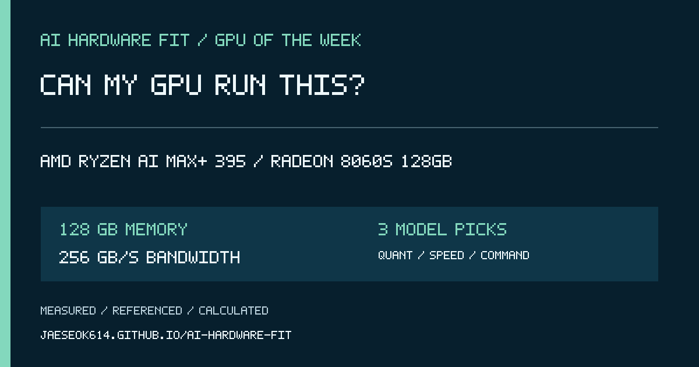

# GPU of the week: AMD Ryzen AI Max+ 395 / Radeon 8060S 128GB 통합메모리

Published 2026-11-16. [Open the Korean result](https://jaeseok614.github.io/ai-hardware-fit/?lang=ko&gpu=ryzen-ai-max-plus-395-128) · [Open the English result](https://jaeseok614.github.io/ai-hardware-fit/?lang=en&gpu=ryzen-ai-max-plus-395-128) · [Copy the Korean/English post text](./posts/2026-11-16-ryzen-ai-max-plus-395-128.md)

The card rotates automatically every Monday at 09:00 KST. Figures are planning estimates; the result page identifies the evidence level behind each speed range.
