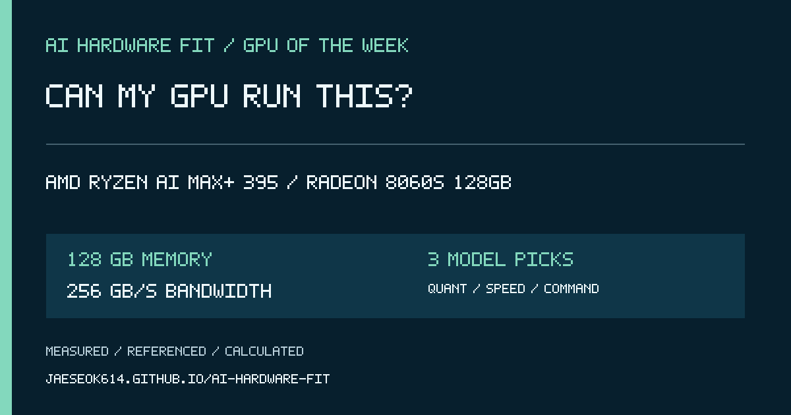

# 2026-11-16 GPU Spotlight — AMD Ryzen AI Max+ 395 / Radeon 8060S 128GB 통합메모리

## 한국어 게시 문안

이번 주 GPU는 **AMD Ryzen AI Max+ 395 / Radeon 8060S 128GB 통합메모리**입니다.

VRAM 128GB, 메모리 대역폭 256GB/s 기준으로 어떤 AI 모델이 들어가고 어떤 양자화가 적절한지, 예상 속도와 실행 명령어까지 한 번에 확인해 보세요.

https://jaeseok614.github.io/ai-hardware-fit/?lang=ko&gpu=ryzen-ai-max-plus-395-128

> 속도는 계획용 범위입니다. 결과 화면에서 동일 조건 실측, 실측 보정, 관련 실측, 외부 참고, 계산 추정을 구분해 표시합니다.

## English post copy

This week's GPU is **AMD Ryzen AI Max+ 395 / Radeon 8060S 128GB unified memory**.

Can my GPU run this? Check which AI models fit 128 GB of memory, the recommended quantization, expected speed range, and a ready-to-run command.

https://jaeseok614.github.io/ai-hardware-fit/?lang=en&gpu=ryzen-ai-max-plus-395-128

> Speed is a planning range, not a guarantee. Each result identifies exact measurements, calibrated estimates, related evidence, external references, or formula-only estimates.

## Source facts

- Memory: 128 GB
- Memory bandwidth: 256 GB/s
- Hardware source: https://www.amd.com/en/products/processors/laptop/ryzen/ai-300-series/amd-ryzen-ai-max-plus-395.html
- Calculator: https://jaeseok614.github.io/ai-hardware-fit/?lang=en&gpu=ryzen-ai-max-plus-395-128
